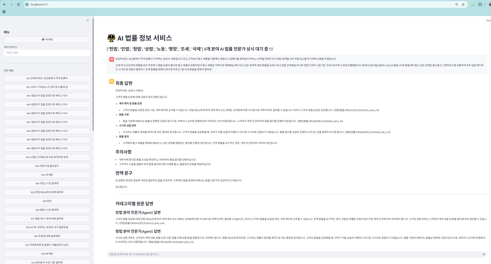
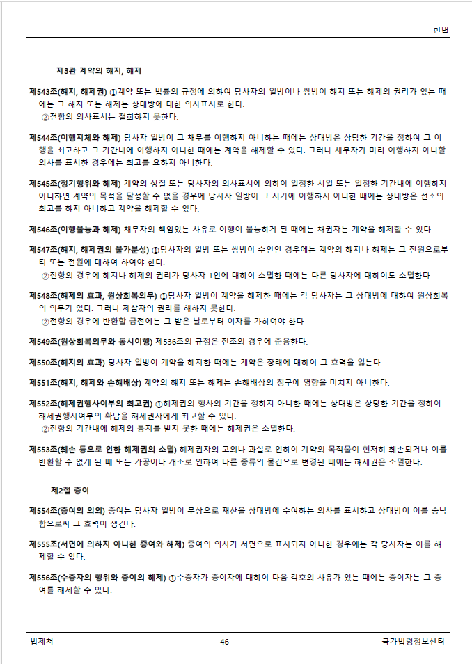

# AI 법률정보서비스 기술 설명서

## 1. 개요

대한민국 법률을 대상으로 카테고리별 멀티 에이전트 + RAG를 구현한 Streamlit 기반 서비스

데이터 소스: data/의 법령 PDF
임베딩/LLM: Azure OpenAI (환경변수로 설정)
벡터스토어: Chroma (PersistentClient), 컬렉션은 법률 분야 8개로 분리
프레임워크: LangChain + LangGraph (멀티 에이전트, ReAct), Streamlit(UI)
저장소: SQLite(대화 로그), Chroma(문서)

## 2. 주요 기능

- 법령 PDF 인덱싱: 편/장/절/조문 단위로 파싱하여 임베딩(정확한 근거 검색/표기)
- 메타데이터 자동 추출: 파일명→(법령명, 유형, 공포번호, 시행일) LLM 추출 (정규식)
- 법령명→카테고리 분류: LLM이용 8개 중 1개로 분류(헌법, 민법, 형법, 상법, 노동, 행정, 조세, 국제)
- 컬렉션 분리: law*docs*{eng} 규칙(예: law_docs_civil)
- 카테고리별 ReAct 에이전트: 각자 자신의 컬렉션만 조회 + 출처(파일명/페이지) 강제
- 간단 질의 재생성: LLM이용 2~3개 핵심 키워드 생성하여 벡터 검색 최적화
- 멀티에이전트 워크플로우(LangGraph):
  > > Route(질의 분류) → Plan(실행 카테고리 결정) → Run Agents(분야별 Agent 병렬 처리) → Synthesize(종합답변 생성)

## 3. 시스템 구성(텍스트 다이어그램)

[Streamlit UI]

- Sidebar: 새채팅/채팅검색/기록, 인덱싱/상태보기, 그래프 시각화
- Main: 채팅창(질의/응답), 인덱싱 진행상황, 그래프

[LangGraph Workflow]

- route → plan → run_agents(민/형/상/헌/행/노/조세/국제) → synthesize → END

[Indexing]

- PDF → 카테고리 분류(LLM이용) → 페이지텍스트 → 법령구조 파서(조문단위) → Document(meta) → Chroma

[Retrieval]

- query_rewrite(LLM이용 간단 키워드 생성) → Chroma(collection by category) → top-k docs

## 4. 데이터/인덱싱 파이프라인

페이지 추출: PyMuPDF로 페이지별 텍스트
법령 구조 파싱: 정규식으로 조문 경계 인식(제12조/제12조의2 등), 편/장/절 추적
문서화: 조문 단위 Document 생성(매우 긴 조문은 2차 분할, subchunk 메타 추가)
카테고리 결정: LLM(고정 프롬프트)로 8개 중 1개 선택 → 컬렉션명은 law*docs*{영문}
재인덱싱: UI에서 선택 파일 또는 전체를 삭제 후 재색인

## 5. 검색/생성(RAG)

카테고리 전용 검색: 질의가 분류된 카테고리의 해당 컬렉션만 조회
사용자 질의 키워드 추출: LLM이용 2~3개 핵심 법률 키워드/조문(키워드 예: “민법 제447조, 가축분뇨의 관리 및 이용에 관한 법률, 기소유예” ) 생성
스니펫/근거: 상위 2~3건(약 240자 스니펫)
→ 에이전트가 반드시 근거를 인용해 최종 답변

## 6. 프롬프트 엔지니어링(핵심)

- Router: 반드시 8개 카테고리 내에서 JSON 한 줄 출력(Few-shot 예시 포함)
- Filename Metadata: JSON 한 줄(미확실 값은 빈 문자열) + 정규식 폴백
- Law Category: 8분류 중 1개만 선택하도록 강제(Few-shot 포함)
- ReAct Agent: 표준 형식 + “툴 1회 사용 후 Final Answer” 가이드
- Synthesize: 중복 제거·충돌 정리·요약 + 인용 근거 유지

## 7. 설정 & 실행

python -m venv .venv
.\.venv\Scripts\activate
pip install -r requirements.txt
data/에 PDF 배치
앱 실행: streamlit run app.py
사이드바 → 인덱싱/상태 보기 → (최초 인덱싱 or 재인덱싱)
메인 채팅에서 질문 입력

### Langfuse 트레이싱

기존 `.env`의 `LANGFUSE_ENABLED=true`와 `LANGFUSE_PUBLIC_KEY`,
`LANGFUSE_SECRET_KEY`, `LANGFUSE_HOST`로 연결합니다.
`LANGFUSE_SYSTEM_NAME`은 트레이스 이름이며, 대화별 `chat-<id>`가 세션 ID입니다.
모든 채팅 트레이스에는 `LegalRag` 태그를 기록합니다.
요청마다 별도 콜백을 사용하고, 병렬 에이전트에도 부모 실행 컨텍스트를 전달합니다.

채팅 워크플로우의 분류, 계획, 분야별 에이전트, 검색 도구, 질의 재작성과
최종 합성의 실행 시간·모델·토큰 사용량·오류를 기록합니다.
`LANGFUSE_CAPTURE_CONTENT=true`이면 질문·프롬프트·검색 결과·응답도 기록하며,
`false`이면 Langfuse로 전송하는 input/output을 `[REDACTED]`로 대체합니다.
PDF 인덱싱은 이 채팅 트레이스 범위에 포함되지 않습니다.

Langfuse가 비활성화되어 있거나 키가 누락된 경우 기존대로 실행합니다.
초기화·전송 실패가 답변 처리를 중단하지 않으며, 요청 종료 시 전송을 flush합니다.
환경변수를 변경하면 앱 프로세스를 재시작하세요.

외부 API 없이 검증: `python -m unittest discover -s tests -v`

# 질의 및 답변 예시

## (VectorStore 에서 문서를 찾은 경우, 출처를 "(형법(법률)(제20908호)(20250408).pdf, p.35)" 와 같이 출력)

⚖️ AI 법률 정보 서비스
['헌법', '민법', '형법', '상법', '노동', '행정', '조세', '국제'] 8개 분야 AI 법률 전문가 상시 대기 중 !!!

사용자:
안녕하세요? 삼산동에서 작게 컴퓨터 가게하는 삼산PC 대표입니다 최근 고객님이 중고 부품을 이용해도 괜찮으니 컴퓨터를 맞춰달라 하여 pc 견적을 맞춰드리고 해당 금액을 모두 부품 입고를 하기위해 사용을 하였습니다.

근데 약 20시간뒤에 부품을 모두 주문하니 환불 요청이 들어와 중고 부품이 포함되있어 중고 부품은 자택으로 택배배송 해드리고 남은 금액에 대한 환불을 요청드리니 당일 전액환불 아니면 안된다 하여 그럼 7일 기다려 보라하고 현재 진행형입니다 현재(25년07월23일자) 168,519원을 1차로 환불 해드렸고 남은 금액은 중고로산 그래픽카드를 포함하여 추후 입금 해드려도 사기죄 등 성립이 될까요?? 전액 환불을 해줘야 한다면 무조건 7일 이내 환불을 해줘야 할까요?

AI Agent:
최종 답변
안녕하세요, 삼산PC 대표님.

고객의 환불 요청에 대해 다음과 같이 답변드립니다:

계약 해지 및 환불 요청

고객이 환불을 요청한 경우, 이는 계약 해지로 간주될 수 있습니다. 민법 제543조에 따라 계약 해지 또는 해제는 상대방에 대한 의사표시로 이루어지며, 철회할 수 없습니다. 따라서 고객의 환불 요청은 유효합니다. (민법(법률)(제20432호)(20250131).pdf, p.46)
환불 기한

환불 기한에 대해서는 법률상 명확한 규정이 없으므로, 계약서나 상거래 관행에 따라 처리하는 것이 바람직합니다. 고객과의 계약 조건에 따라 환불 절차를 진행하시면 됩니다. (형법(법률)(제20908호)(20250408).pdf, p.35)
사기죄 성립 여부

사기죄는 재물의 편취를 목적으로 하는 행위로 정의됩니다. 고객이 환불을 요청했을 때, 귀하가 이를 성실히 이행하고 있다면 사기죄로 성립되기 어렵습니다. 환불 절차를 성실히 진행하고 있다는 점을 명확히 하시면 됩니다. (형법(법률)(제20908호)(20250408).pdf, p.35)
환불 절차

고객에게 중고 부품을 택배로 배송하고, 남은 금액을 환불하는 절차를 진행하시면 됩니다. 전액 환불을 요구하는 경우, 계약 조건에 따라 처리하시면 됩니다.
주의사항
계약서에 명시된 환불 조건을 확인하고, 이에 따라 환불 절차를 진행하십시오.
고객과의 소통을 원활히 하여 환불 절차에 대한 이해를 돕고, 불필요한 분쟁을 예방하십시오.
면책 문구
본 답변은 제공된 정보에 기반한 일반적인 법률 조언이며, 구체적인 법률 문제에 대해서는 법률 전문가와 상담하시기 바랍니다.

감사합니다.

카테고리별 원문 답변
민법 분야 전문가(Agent) 답변
고객의 환불 요청에 대해 민법 제543조에 따라 계약 해지 또는 해제는 상대방에 대한 의사표시로 이루어지며, 철회할 수 없습니다. 따라서 고객이 환불을 요청한 경우, 계약 해지로 간주될 수 있습니다. 전액 환불을 요구하는 경우, 민법상 특별한 규정이 없으므로 계약 조건에 따라 처리해야 합니다. 사기죄 성립 여부는 고객과의 계약 내용 및 환불 절차에 따라 달라질 수 있습니다. (민법(법률)(제20432호)(20250131).pdf, p.46)

형법 분야 전문가(Agent) 답변
사기죄 성립 여부는 고객과의 계약 내용, 환불 요청 시점, 환불 진행 상황 등을 종합적으로 고려해야 합니다. 형법 제346조에 따르면, 사기죄는 재물의 편취를 목적으로 하는 행위로 정의됩니다. 고객이 환불을 요청했을 때, 귀하가 이를 성실히 이행하고 있다면 사기죄로 성립되기 어렵습니다. 환불 기한에 대해서는 법률상 명확한 규정이 없으므로, 계약서나 상거래 관행에 따라 처리하는 것이 바람직합니다. (형법(법률)(제20908호)(20250408).pdf, p.35)
